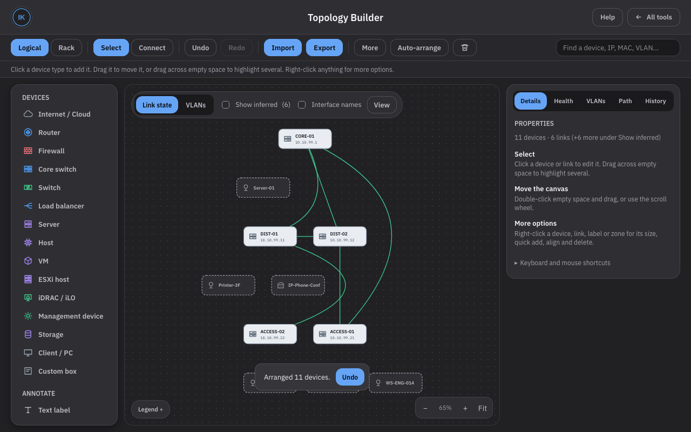
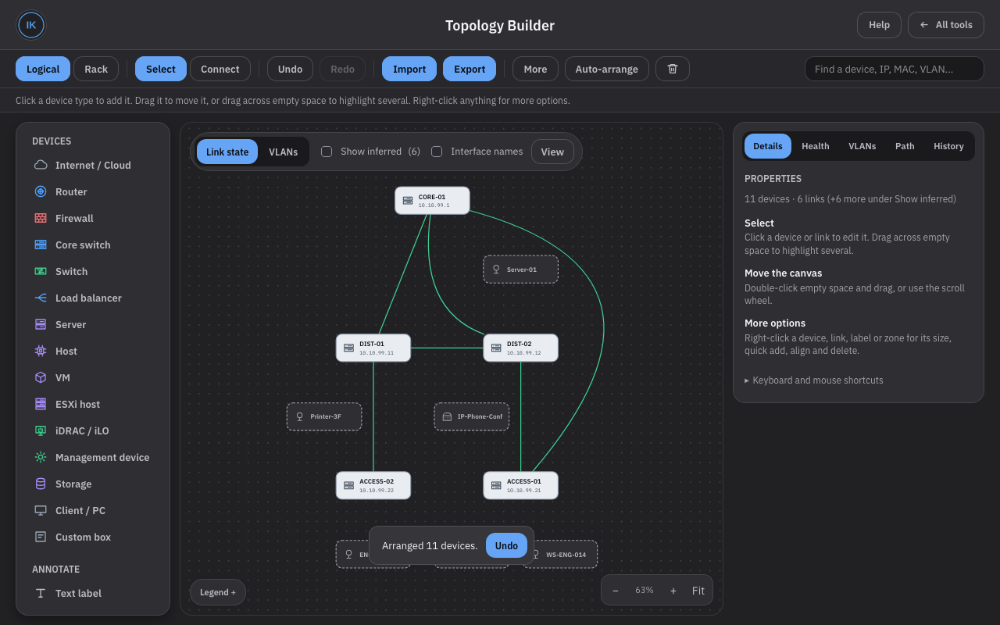
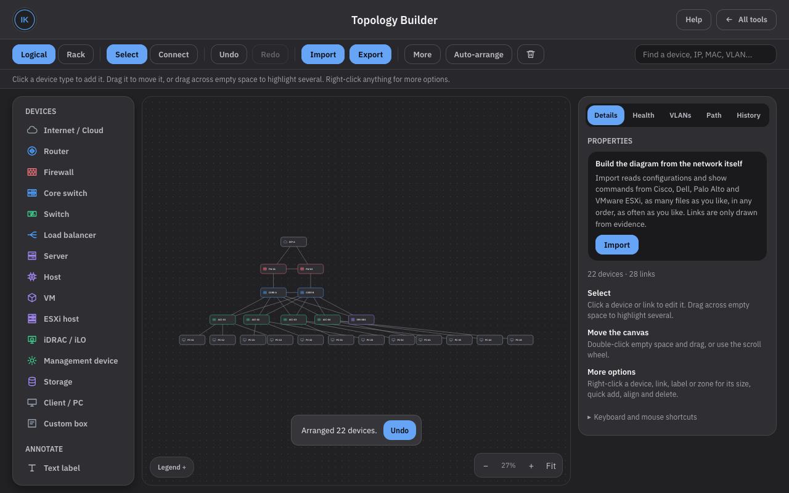
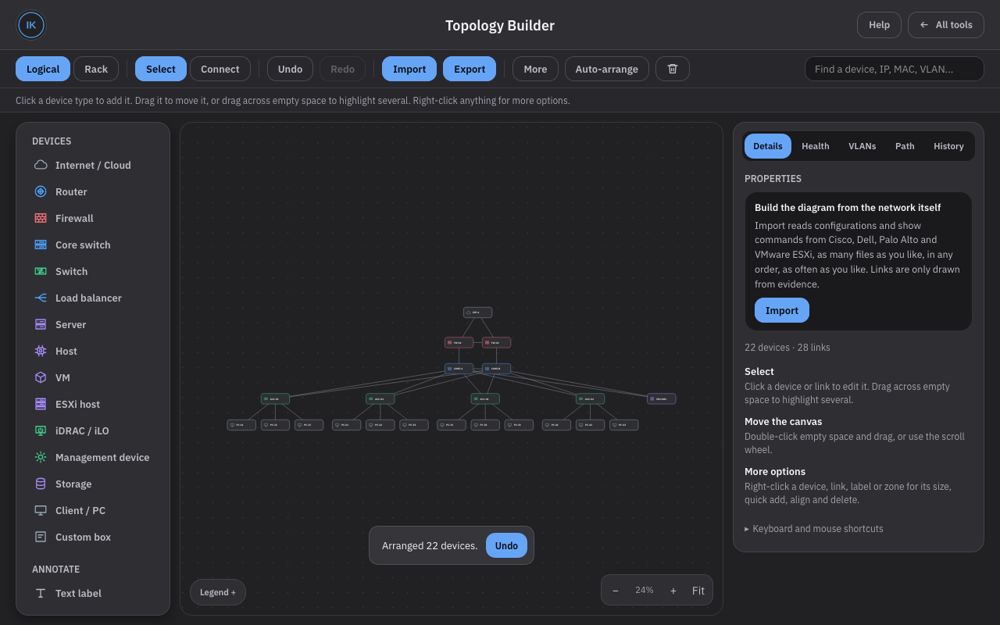
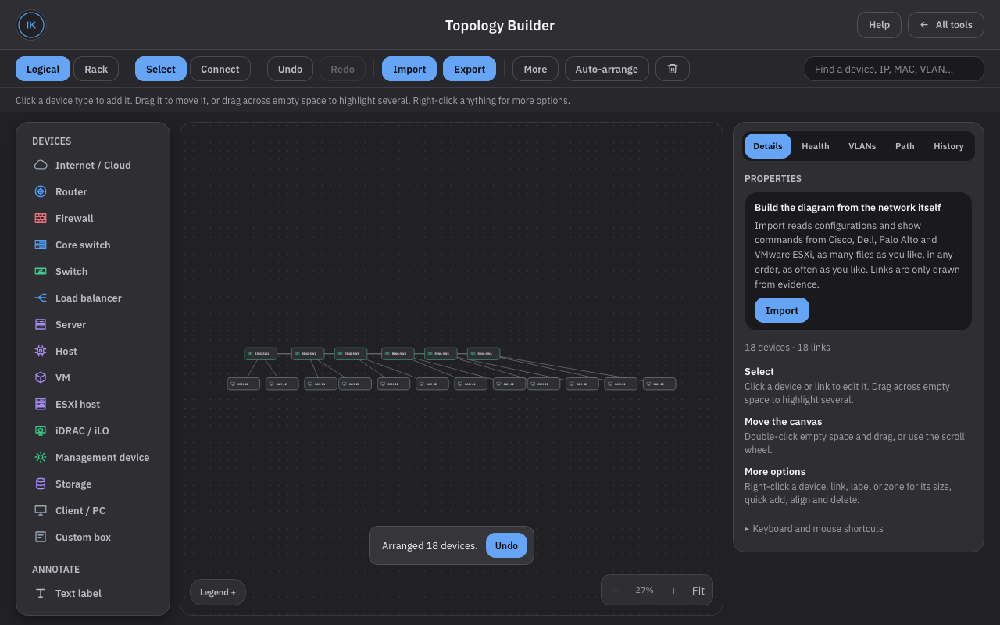
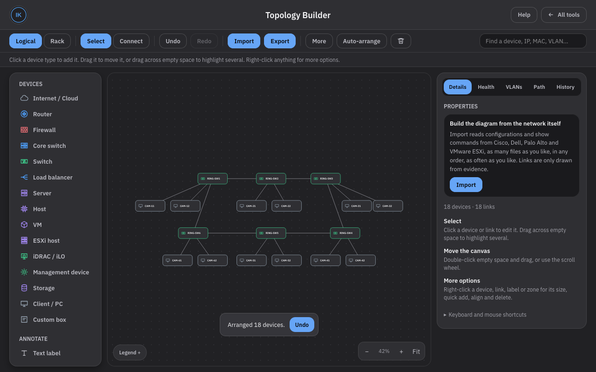
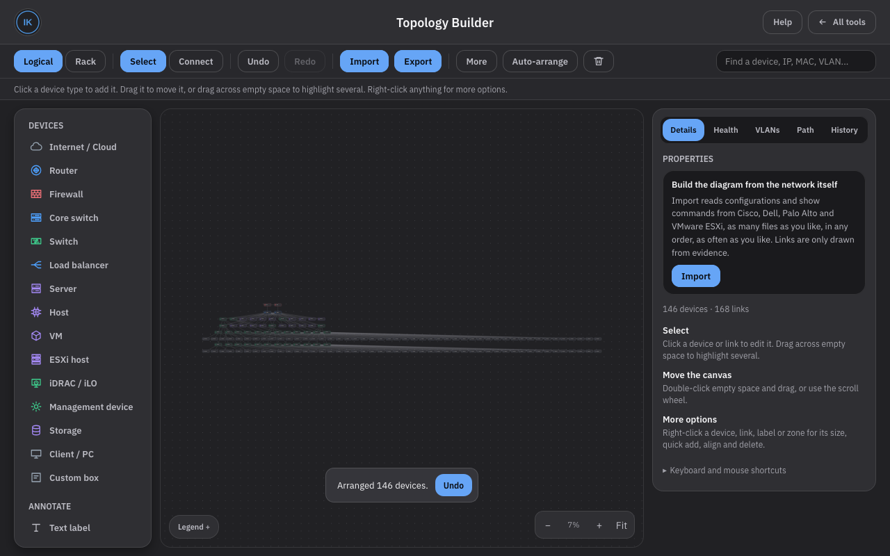
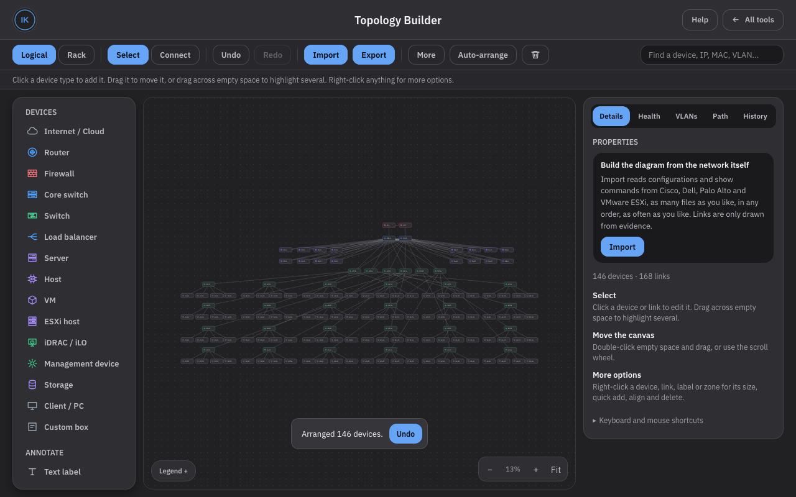

# Workplace v1.10 integration: Topology Builder, 2026-11-05

This pass compares the Topology Builder in the workplace copy labelled NetOps Workspace 1.10 with GitHub `main`, takes what is worth keeping, rewrites what was weak, and leaves out what would make the tool less accurate. The workplace file was not copied over `index.html`. Nothing is pushed.

## 1. Starting point

- `main` at `26382889fb024c32dfc87d1abe4673816f71bf3f` (`2638288`), equal to `origin/main` after `git fetch`. This is the expected baseline.
- Working tree clean, nothing unpushed.
- Baseline tests on that commit, before any change: 20 syntax checks, 95 engine tests, 36 of 36 browser test files.

## 2. The workplace file

| | |
| --- | --- |
| File | `Premium_IT_Skills_Kit1.10.html` |
| Size | 3,003,923 bytes |
| SHA-256 | `fdca7f3e14925b241ef8fe87bd7780ff6d6f297ef4c8dd72ccce054007875dae` |
| Label | `KIT_VER = "1.10"`, header comment "NetOps Workspace 1.10" |

I split both files into their 13 tool blocks and compared each block, and compared the blocks with every Wave 1 commit as well.

- **Built from `166fd46`**, the commit before Wave 1. Its Log Sanitizer and Switch Lab blocks are byte for byte the ones at `166fd46`. So it has none of the F-04, F-01, F-03 or R-01 fixes, and its Topology Builder has neither F-02 nor R-01.
- **The only real change is in the Topology Builder**: 105 changed lines against the `166fd46` block. The other 12 tools are identical to `166fd46`, apart from the Wave 1 changes it lacks.
- The hub differs only in the version label (1.7 to 1.10).

So the useful part is small and easy to isolate. Copying the file over `index.html` would have undone all of Wave 1.

## 3. Change inventory

Every change in the workplace Topology Builder, against `166fd46`:

| # | Workplace change | Current GitHub behaviour | Benefit | Risk | Decision |
| --- | --- | --- | --- | --- | --- |
| W1 | `guessKind`: `vmh-N` names are ESXi | ESXi only from `esx` names or platform | Real naming pattern | Low | **Integrate**, as a whole name part |
| W2 | `guessKind`: names with `ap`, `pc`, `cam`, `printer`, `phone`, `badge`, `laptop` return `client` | Kind from LLDP/CDP capabilities, `unknown` from name | Fills gaps | `client` is not an engine kind: the icon and legend for AP/phone/endpoint are lost. These rules run before the capabilities, so a name beats evidence | **Improve**: name parts map to `ap`, `phone`, `endpoint`, only when there is no stronger evidence |
| W3 | `guessKind`: `core` + `sw` in the name returns `core` | `core` only from Router+Switch capabilities or config | Core switches recognised | Ran before capabilities | **Improve**: the name may refine a switch to a core switch, never change a class |
| W4 | `guessKind`: `access`/`acc`/`asw` + `sw` returns `switch` | Already `switch` from `sw` | None | None | **Already present** (kept, now whole-part) |
| W5 | `guessKind`: `rtr`, `router` or `edge` returns `router` | `rtr`/`router` already router | `edge` | `edge` is as often an edge switch | **Reject** `edge`; keep `rtr`/`router` |
| W6 | LLDP capabilities W, T/P and E return `client` instead of `ap`, `phone`, `endpoint` | Own kinds and icons | None | Loses the AP, phone and end-station icons. Fails the existing test "an LLDP station is an end device and a WLAN access point and a telephone have their own kinds" | **Reject** |
| W7 | Prompt host pattern `[^\s#>(]+?` (any characters) | Host must start with a letter, `[\w.-]` after | Reads Log Sanitizer output (`[SITE_1]-...#`) | Accepts punctuation and junk as a host name | **Improve**: accept only `[LABEL_N]` and `<LABEL_N>` placeholders and a leading digit; require a letter |
| W8 | Fallback prompt `^\s*(\S+)\s*[#>]\s*(show\|sh\|display)` | None | More prompts read | Any line like `x> show ...` becomes a new device section | **Reject** |
| W9 | Dell LLDP: a MAC followed by a non-MAC last token: chassis = MAC, port = last token | Port = "MAC vmnic0" glued together | ESXi rows read | Any non-MAC token is assumed to be a port | **Improve**: only a `vmnicN` token is moved; header order kept otherwise |
| W10 | Dell LLDP: two MACs at the end: port = first MAC | Same result already | None | None | **Already present** |
| W11 | Dell LLDP: a row starting "Not Advertised" is dropped | "Not" becomes the host name, "Advertised vmnic2" the port | Avoids a bogus device | Throws away a real one-sided observation and its port | **Improve**: "Not Advertised" is read as an empty field anywhere in the row; the row is kept |
| W12 | Dell LLDP: a trailing `...` or `…` is stripped from the host | Name kept with dots | Better name | A cut name becomes a different device | **Improve**: strip, warn, match to a known device only when exactly one name starts with it |
| W13 | Dell LLDP: a row with no host and only MACs is dropped | Kept as a stub named by its MAC (flagged `noName`) | Fewer stubs | Loses one-sided neighbours; requirement 5 says keep them | **Reject** |
| W14 | `NMX_RANK` gains `ap`, `phone`, `endpoint`, `unknown` | Not used | None in practice: node types are never `ap` or `phone` | None | **Improve**: rank by the device kind behind a `custom` node (`nmxRank`) |
| W15 | Layout row spacing up: row step +24 px, cell +8 / +22 px | 132 px end-device step, 130 px rows | More room for labels | Taller and wider in every case | **Improve**: end-device step +8 px (140 px); rows unchanged |
| W16 | Layout `nameLayer`: rows decided from the name (`isp`, `fw`, `core`, `dist`, `acc`, `srv`, `ap`, `pc` ...) before the type | Rows from the type and the graph; names only break ties between switch rows | Names placed by convention | `CORE-TEST-PC` goes to the core row, `srv-switch-01` to the server row | **Reject**; keep and tighten the tie-break |
| W17 | Layout: rows equal to rank only; graph distance and the peer rule removed | Rows from graph layering plus rank | Same roles share a row | Ignores real relationships: chained switches and rings flatten into one row. 1,918 crossings on the large network vs 552 | **Reject** |
| W18 | Version label 1.10 | 1.7 | | | **Not taken**: a release decision for you |

I found no security or persistence change in the workplace copy: it touches no storage, export, CSP or sanitising code. Its persistence code is simply the older, pre-R-01 version.

## 4. Accepted changes

- W1 `vmh` names, W4 access names: integrated, as whole name parts.

## 5. Improved changes

**Device kind (W2, W3, W5, W14).** `guessKind` now goes by evidence first:

1. Management names (iDRAC, iLO, BMC and so on), unchanged.
2. Platform: Palo Alto, ASA, Firepower, FortiGate, SRX is a firewall; ESXi or VMware is an ESXi host.
3. LLDP/CDP capabilities. Phones and access points that also report Bridge are a phone and an access point (before, `B,T` and `B,W` were switches). A firewall or ESXi host that reports Router or Switch is named from its host name, because that is how they report themselves. A switch whose name says core is a core switch.
4. The host name, only when nothing above decided.

Names are read by `nameKind`, part by part. Only a whole part counts, with digits at its end ignored: `sw01` is `sw`, `cr1` is `cr`. A name whose parts point different ways says nothing, so `CORE-TEST-PC`, `DIST-PRINTER`, `fw-mgmt-pc` and `AP-CORE-LAB` stay unknown. `core` + `sw` is a core switch. A switch part with server parts (`srv-sw-01`) is a switch.

Name evidence still has the lowest rank (1) in `setKind`, so a configuration (rank 2) or vendor output (rank 3) always wins. A type you picked by hand on the canvas is not touched by any of this.

Two old name bugs went away with the part-based reading: any name starting with `pa` was a firewall (`paris-sw1`, `PARKING-AP`), and `fw-mgmt-pc` was a firewall.

**Prompts (W7).** A host may contain Log Sanitizer placeholders `[LABEL_N]` or `<LABEL_N>`, and may start with a digit. It must contain a letter. Before: `[SITE_1]-lab-sw2# show ...` and `6509-core#` were not read as prompts. Now they are, and `1>show`, `Note: run this> show me` and `[SITE 1]-sw2#` are still not.

**Dell LLDP (W9, W11, W12).** In `dell.lldp`:

- "Not Advertised" in any column is an empty field. A row with no host keeps its port and its chassis MAC; the neighbour becomes a stub named by the MAC, as other host-less rows already did. A last row whose chassis is "Not Advertised" is not reported as cut off (F-02j still fires for a truly missing chassis).
- `vmnicN` in either of the last two columns, next to a MAC, is the remote port, and the MAC is the chassis.
- A remote port `vmnicN` marks the neighbour as an ESXi host even when its name does not say so.
- A host name ending in `...` or `…` loses the dots, gets a warning, and joins a known device only if exactly one device name starts with it. Otherwise it stays a separate device under the cut name.

**Layout (W14, W15).** See section 10.

## 6. Rejected changes and why

- **W6** `client` for AP/phone/station: loses kinds and icons; fails an existing test.
- **W8** catch-all prompt: any text before `#` or `>` followed by `show` starts a new device.
- **W13** and the drop in **W11**: throw away one-sided observations.
- **W5** `edge` is a router: wrong as often as right.
- **W16** rows from names and **W17** rows from rank only: they place devices by naming convention instead of by their links. With the workplace layout, `CORE-TEST-PC` is drawn above its own switch (hierarchy violation in the misleading-names fixture) and the large network has 1,918 crossings.
- **W18** version bump: left for you.
- The workplace Log Sanitizer, Switch Lab, Dell OS10 rows and Topology Builder autosave are pre-Wave 1 and were not used.

## 7. Device classification findings

`tests/engine/suite.mjs` W-01 to W-04 cover these. Selected results:

| Name | Capabilities / platform | Result |
| --- | --- | --- |
| `CORE-01` | none | core |
| `CORE-01` | E (station) | endpoint |
| `CORE-01` | B | core |
| `CORE-TEST-PC` | none | unknown |
| `CORE-TEST-PC` | B | switch |
| `core-01` | platform PA-3220 | firewall |
| `esx01` | S | esxi |
| `SW-PHONE-LAB` | B,T | phone |
| `core-sw-9` | B,W | ap |
| `Server-01` | E | endpoint |
| `paris-sw1` | none | switch (was firewall) |
| `SEP0011223344AA` | none | phone |
| `vmh01` | none | esxi |
| `LAB-PC-07` with a Cisco switch config | config | switch (configuration wins) |

## 8. Parser improvements

W-05 and W-06: Cisco IOS/IOS-XE (`SW1#`), Dell OS9 (`Dell#`, `S4048(conf)#`), Dell OS10 (`OS10#`, `leaf1(conf-if-eth1/1/1)#`), dotted (`sw1.lab.example#`), hyphenated, leading digit, bracketed Linux/ESXi (`[admin@esx01:~]`), Log Sanitizer placeholders, a three-device paste split on each prompt with the right line numbers, and lines that must not be prompts. Incomplete data is handled as before: a section with no prompt still asks which device it came from. When the prompt and the output name different devices, the existing note ("The prompt says ... but the output itself says ...") still appears; I did not change it.

## 9. Dell and VMware compatibility

W-07 to W-14, plus all of F-02a to F-02k unchanged and passing:

- "Not Advertised" host, port or chassis (W-07, W-08).
- `vmnic` as the port in either column order, ESXi kind from `vmnic`, no MAC in a port or a name (W-09).
- OS9 two-word local ports with ESXi neighbours, labelled "Dell OS9 show lldp neighbors" (W-10).
- MAC-only rows kept as one-sided stubs, link inferred, never confirmed (W-11).
- Cut names, one candidate and two candidates (W-12).
- The same paste imported twice: no new devices or links (W-13).
- One ESXi host seen by two leaves on different vmnics: one device, one link per cable (W-14).

The browser test `topology-auto-arrange` repeats this through the real import dialog with sanitized prompts and checks that the leaf-to-leaf cable is confirmed by both ends.

## 10. Auto Arrange

### What changed (algorithm C)

All in `nmxLayered` and `nmxLayeredCore`, drawing code only:

1. `nmxRank`: an imported AP, phone or end station (node type `custom`, kept for its icon) ranks as an end device. Before, it ranked 3.5, between switches and servers. A type picked by hand is used as it is. `nmxPlaceNew` uses the same rank.
2. Each switch gets the width its own end devices need, so they stay under it. Before, the end devices of a row were pushed right one after another and ended up far from their switch. More than six end devices go on lines of six.
3. A switch that also has links going down puts its end devices to the side of those links when there is room within one device width. When its links fan out to both sides, its end devices join the next row and are ordered next to it. They never sit in a row of their own where those links pass. The side room is checked again after the slots are widened (up to three rounds).
4. Peers: two devices of the same kind and distance from the top that link to each other share a row. The old rule also required the same number of links, which split a collapsed-core pair onto two rows.
5. A device with no link along its row is moved out from between two devices on that row that link to each other.
6. A link that skips a row gets a narrow stand-in on each row it crosses, so the ordering keeps a gap for it.
7. Each line is placed under the devices it links to above, within the width above, instead of every line being centred on its own.
8. A row that is one ring of four or more devices is drawn as a loop on two lines.
9. Rows wrap by the width they need, not by a device count, and a line holds at least six devices.
10. When a row with distribution switches has to wrap and also holds servers, hosts or storage that link only upwards, those go on lines above, split left and right, so links to the switches come down the middle.
11. Devices with no switch links are spaced by the width their end devices need (before, they could overlap; found by the new pinned-device test).
12. Name tiers (core, distribution, access) still only break ties between switch rows, and now need a whole name part (`spine` and `leaf` are not tiers; `corey` is not core).

Unchanged: pinned devices are left alone and the rest is placed beside them; devices in zones are arranged per zone; nothing moves unless you click Auto Arrange; links, interface names, confirmed and inferred styles, grid, zoom, filters, history and saved projects are untouched.

### How it was measured

`docs/reviews/evidence/2026-11-05-layout/layout-compare.mjs` cuts the layout code (`NMX_RANK` to `nmxArrange`) out of each build and runs it in Node on the same ten graphs from `fixtures.mjs`, with the same 1280x800 aspect and 20 px grid snap. A is `2638288`, B is the workplace file, C is this change. Node kinds are the same for all three, so only the layout differs. Run it with:

```sh
node docs/reviews/evidence/2026-11-05-layout/layout-compare.mjs A=/path/to/old.html B=/path/to/workplace.html C=index.html
```

Columns: overlaps; crossings (straight links, parallel links counted once); through (links whose straight line crosses a device box with 6 px margin; the app bends these around boxes afterwards); hierarchy violations (an upper-tier device drawn below a lower-tier neighbour); end-device distance to its switch, mean and max; total link length; long links (over 2.5 times the median); links too short for both interface labels (under 78 px between boxes, where the label spacing gives way); width and height; zoom Fit would need in 1280x800; devices that move when the same graph is given in a different order; time per run.

### Results

Full table in `docs/reviews/evidence/2026-11-05-layout/results.txt`. Main numbers:

| Fixture | Build | Cross | Through | Hier. viol. | End dev. mean / max px | Long links | Width x height | Fit |
| --- | --- | --- | --- | --- | --- | --- | --- | --- |
| Five-switch | A | 2 | 3 | 0 | 175 / 213 | 1 | 632 x 756 | 0.95 |
| | B | 2 | 2 | 0 | 190 / 213 | 1 | 632 x 876 | 0.82 |
| | C | 2 | 2 | 0 | 174 / 228 | 0 | 632 x 776 | 0.93 |
| Redundant core | A | 13 | 7 | 0 | 543 / 1146 | 3 | 2092 x 636 | 0.57 |
| | B | 19 | 8 | 0 | 568 / 1171 | 3 | 2132 x 896 | 0.56 |
| | C | 10 | 4 | 0 | 199 / 228 | 6 | 2392 x 656 | 0.50 |
| Collapsed core | A | 4 | 3 | 0 | 254 / 481 | 0 | 1232 x 776 | 0.93 |
| | B | 1 | 3 | 0 | 419 / 777 | 0 | 1952 x 556 | 0.61 |
| | C | 0 | 0 | 0 | 174 / 228 | 2 | 2032 x 496 | 0.59 |
| Dell + VMware | A | 10 | 1 | 0 | - | 0 | 992 x 496 | 1 |
| | B | 10 | 1 | 0 | - | 0 | 1012 x 556 | 1 |
| | C | 10 | 0 | 0 | - | 0 | 992 x 496 | 1 |
| Dual-homed servers | A | 15 | 6 | 0 | 170 / 170 | 0 | 1192 x 496 | 1 |
| | B | 15 | 6 | 0 | 184 / 184 | 0 | 1232 x 556 | 0.97 |
| | C | 15 | 4 | 0 | 636 / 636 | 1 | 1612 x 356 | 0.74 |
| LACP / parallel | A | 0 | 0 | 0 | 233 / 331 | 0 | 772 x 636 | 1 |
| | C | 0 | 0 | 0 | 219 / 313 | 0 | 732 x 656 | 1 |
| Ring | A | 0 | 6 | 0 | 414 / 832 | 4 | 2092 x 196 | 0.57 |
| | B | 0 | 5 | 0 | 421 / 816 | 2 | 2132 x 216 | 0.56 |
| | C | 0 | 1 | 0 | 204 / 349 | 0 | 1372 x 476 | 0.87 |
| Conflicting LLDP | A | 2 | 4 | 0 | 177 / 184 | 0 | 512 x 496 | 1 |
| | C | 1 | 2 | 0 | 192 / 213 | 0 | 792 x 496 | 1 |
| Misleading names | A | 0 | 0 | 0 | 184 / 251 | 0 | 852 x 336 | 1 |
| | B | 0 | 0 | **1** | 216 / 340 | 0 | 612 x 716 | 1 |
| | C | 0 | 0 | 0 | 161 / 172 | 0 | 912 x 356 | 1 |
| Large, 146 devices | A | 552 | 140 | 0 | 2757 / 5722 | 52 | 8432 x 1036 | 0.14 |
| | B | 1918 | 133 | 0 | 2803 / 5822 | 44 | 8612 x 1356 | 0.14 |
| | C | 368 | 42 | 0 | 232 / 313 | 48 | 4352 x 1716 | 0.28 |

No build had overlaps in any fixture. All three are repeatable, and none moved a device when the input order changed. C takes 0.02 to 0.4 ms per run in Node; in the browser, Auto Arrange on 146 devices took 15 ms, and the drawing came out 4352 x 1716 px, the same as in Node.

### Where C is worse

- **Dual-homed servers:** the two workstations on the server switches move to the server row (rule 3, links fan both ways), so they sit 636 px from their switch instead of 170, and the drawing is wider. In return, 2 fewer links run through a box. I took this trade because the old placement drew the workstations right where 12 server links cross.
- **Large network:** long links rise from 36 (an earlier C without rule 10) to 48, because ESXi and storage hosts move to the sides. Links through boxes drop from 55 to 42 and the switches sit directly over their access rows. Total link length is still less than a third of A.
- **Redundant core:** 3 more long links than A (the dual-homed access switches spread wider) and a little wider, with 3 fewer crossings and end devices 3 to 5 times closer.
- **Collapsed core:** wider than A (2032 vs 1232 px) because both cores now share the top row, as they should; crossings and through-links drop to 0.
- **Large network canvas:** still needs zoom 0.28 to fit 1280x800. 146 device boxes cannot be read at Fit on that screen in any layout I tried; it is twice as readable as A.

### What I tried and dropped

- Breaking wrapped rows where the parent switch changes (one distribution switch's access switches per line): long links went from 36 to 50 and total length up, so it was removed.
- Keeping end devices of a switch with downward links on the side away from the links in every case (the original rule): it put them where the links cross on the dual-homed fixture.

### Screenshots

Taken in the real page, 1280x800, headless Firefox, after Auto Arrange and Fit. A is `2638288`, C is this change. Same input for both.

| | A (GitHub) | C (this change) |
| --- | --- | --- |
| Five-switch, imported from CLI |  |  |
| Redundant core |  |  |
| Ring |  |  |
| 146 devices |  |  |

## 11. Export compatibility

- JSON project: no change to the format. The new browser test saves a project after Auto Arrange with a pinned device, loads it back and gets every position and the pin.
- draw.io export: `topology-drawio` passes unchanged (structure, escaping, shapes, links).
- PNG/SVG image export and the encrypted copy: unchanged code; `topology-projects-and-snapshots` and `topology-encrypted-copy` pass.
- Device icons: the five-switch test's icon check (AP, phone and stations each get their own icon; a type picked by hand wins) passes.

## 12. Saved-data compatibility

- No schema change, so no migration.
- Saved kinds are stored in the model and are not re-guessed on load. A device saved with an old name-based kind (for example `paris-sw1` as a firewall, rank 1) keeps it, and a later import's name evidence (also rank 1) does not replace it. Configuration or vendor output does. Clearing and re-importing gives the new kinds.
- Two new optional neighbour flags, `nameCut` and `noChassis`, are used only while importing.
- R-01 autosave conflict handling: `topology-autosave-tabs` passes unchanged.

## 13. New regression tests

- `tests/engine/suite.mjs`, W-01 to W-14 (109 tests in total, 95 before). On `2638288`, 9 of the 14 fail; the other 5 guard behaviour that was already right and that the workplace copy breaks or could break (configuration beats name, OS9 ports, MAC-only rows kept, duplicate imports, one ESXi host on two leaves). On the workplace file, W-01, 02, 03, 05, 07, 09, 11 and 12 fail, as do F-02a, d, f, g, h, i and j and the existing LLDP kinds test.
- `tests/browser/topology-auto-arrange.test.mjs`, 18 checks: real import of Dell + ESXi with sanitized prompts, a later import not moving drawn devices, Auto Arrange keeping links and interface names with no overlaps and no straight link through a device, the 146-device network (overlaps, end devices within 320 px and below their switch, under 5000 px wide, firewalls and cores on top, under 1.5 s, repeatable), a pinned device, a saved project loading back, and the ring.
- `tests/README.md` and `CHANGELOG.md` updated.

## 14. Test results

On the final code (`index.html` as committed):

| Suite | Result |
| --- | --- |
| `node scripts/check-scripts.mjs` | 20 checked, 0 failed |
| `node tests/engine/suite.mjs` | 109 passed, 0 failed |
| `node tests/engine/fuzz.mjs 800` | 800 batches, 0 exceptions, 0 slow batches, Object.prototype clean |
| 17 tool runners (sanitizer 61, configdiff 9, calculator 5, routing 4, switching 23, switchlab 55, pcdiag 28, vsphere 8, dns 11, ping 23, lessons 6, content 11, scriptrepo 9, os9cheat 18, os10native 8, uitokens 69, progress 12) | all passed |
| `sh tests/run.sh` | 37 of 37 files passed (36 existing plus `topology-auto-arrange`), no console errors |

Wave 1 protections, checked by name: F-04 (`sanitizer`, 61), F-02 (F-02a to F-02k in `suite`), F-01 (`fault-lab-leave`), F-03 (`os10native`, 8), R-01 (`topology-autosave-tabs`). The Log Sanitizer, Switch Lab and Cheat Sheet blocks are byte for byte unchanged from `2638288`.

## 15. Performance

- Engine: fuzz 800 batches in about 4.6 s with no slow batch. The 120-device engine benchmark in `suite` is unchanged in shape (parse about 170 ms).
- Layout: 0.02 to 0.4 ms per run in Node on the fixtures; 15 ms for Auto Arrange on 146 devices in the page. The two-pass and refinement steps make C slower than A on the large network (0.39 ms vs 0.20 ms), which is not noticeable.

## 16. Security and offline

- No new network request, library, CDN or API. The diff adds no `http`, `fetch`, `eval`, `innerHTML` or CSP change.
- Imported names reach the page through the same escaping as before. Warnings quote at most 70 characters of a row, as the existing ones do.
- The fuzz run (damaged and mixed output, 800 batches) covers the new parser branches with no exception.
- Every name, address and MAC in fixtures, tests and this report is made up. The workplace file's own example host name was replaced with a fictional one.

## 17. Limits

- **Cut host names**: matched only to devices known at import time. If the switch with the cut name is imported before the device itself, a separate device with the cut name is created and is not merged later.
- **vmnic column order**: I could not confirm from VMware or Dell documentation which column ESXi's `vmnic` lands in on Dell `show lldp neighbors`. The parser accepts either, and only for a `vmnicN` token next to a MAC. Other non-MAC tokens keep the header order (port, then chassis).
- **Name parts** are English and common abbreviations. Site-specific schemes (building codes, numbers only) give no kind, which is the intended fallback.
- **Layout** is still straight lines between box centres. Through-links are reduced, not removed; the app bends the rest around boxes when it can. Big networks still need zoom or zones.
- **Existing saved kinds** are not re-guessed (section 12).
- Not checked on real Dell, Cisco or ESXi hardware. Samples are synthetic, written to match the documented formats.
- `guessType` in the drawing code's quick neighbour paste was not changed; the workplace copy did not change it either.

## 18. Local commits

| Commit | What |
| --- | --- |
| `7c9291f` | Engine: device kind, prompts, Dell LLDP with ESXi, tests W-01 to W-14 |
| `fcda126` | Auto Arrange, browser test `topology-auto-arrange`, layout harness and results |
| `88621bd` | This report, screenshots, CHANGELOG, tests README |
| (this commit) | Commit list filled in |

The tested `index.html` is byte for byte the one in `fcda126`.

Nothing pushed. No remote branch created. History not rewritten.
